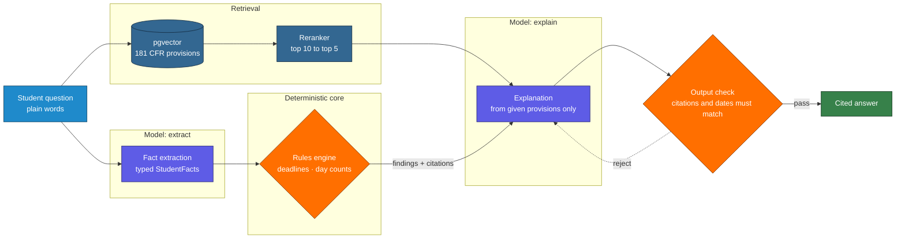
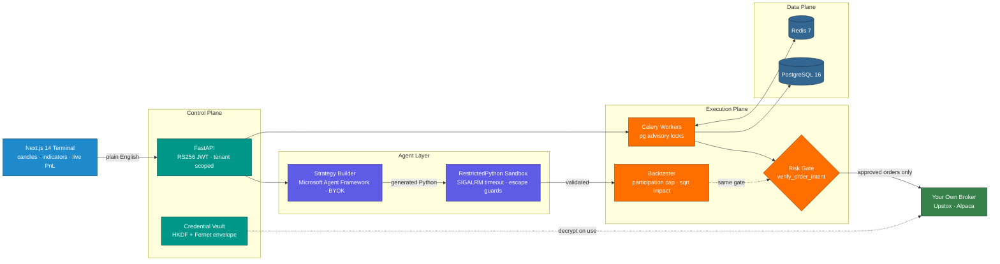
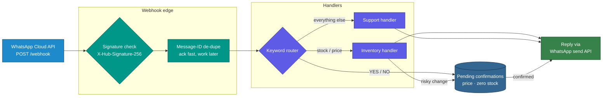
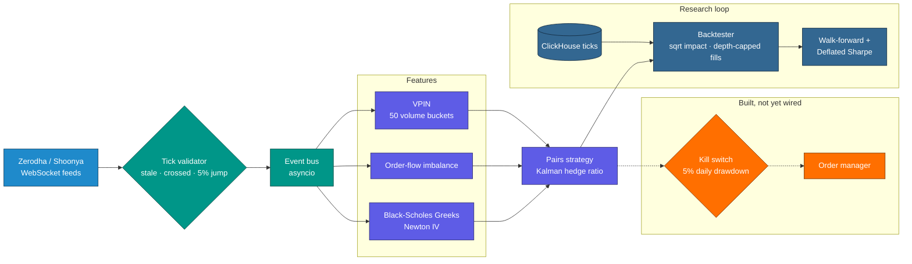
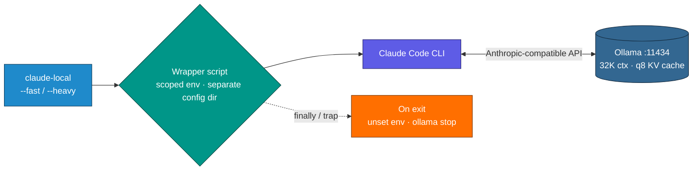

  

  
  

<h3 align="center">AI engineer building LLM systems where a wrong answer has a price.</h3>

  Trading infrastructure · regulatory Q&A · small-business agents

### Hi, I'm Ankit

I'm an AI engineer and data scientist, an NIT Jaipur graduate living in Gurgaon. I build LLM systems for places where a wrong answer costs something real: money in a brokerage account, a student's visa deadline, a shop's stock.

Right now I'm running the answer-quality evals for Niyam and building a startup around AI agents for small shops (private while it's in development). I'm open to AI engineering roles and contract work.

 

## How I build

> **The model proposes. Code decides.**

LLMs extract, draft and explain. The parts that have to be right (an order, a legal deadline, a stock change) live in plain, tested code, behind a gate the model can't talk its way past. Each project below is a different place to apply that rule, and each lists where it still falls short.

 

## Selected work

| Project | What it does | Evidence |
|---|---|---|
| [**Niyam**](https://github.com/Algo-Ankit/Niyam) | Answers F-1 OPT questions with the regulation paragraph cited and every deadline computed in code | Retrieval hit@1 0.857 vs 0.086 for keyword · 108 tests · `mypy --strict` · [results write-up](https://github.com/Algo-Ankit/Niyam/blob/main/RESULTS.md) |
| [**AlphaSwarm**](https://github.com/Algo-Ankit/AlphaSwarm) | An LLM writes a trading strategy, a sandbox runs it, and a risk gate decides whether it can reach your broker | 9-check risk gate on every order path · 117 tests (28 on the sandbox) · CI · [architecture doc](https://github.com/Algo-Ankit/AlphaSwarm/blob/main/ARCHITECTURE.md) · [quant maths](https://github.com/Algo-Ankit/AlphaSwarm/blob/main/docs/QUANT_MATH.md) |
| [**agent-towhatsapp**](https://github.com/Algo-Ankit/agent-towhatsapp) | Lets a shop owner manage inventory over WhatsApp, with risky changes held for a "YES" | Webhook signature checked before parsing · retry de-duplication · demo-grade |
| [**TradeProject**](https://github.com/Algo-Ankit/TradeProject) | Event-driven research stack for NSE India (paper only) | Deflated Sharpe validation · 45 tests · early stage |
| [**claude-code-local-models-runtime**](https://github.com/Algo-Ankit/claude-code-local-models-runtime) | Runs Claude Code on local Ollama models in an isolated config | VRAM sizing worked through for 6–16 GB cards |

 

### Niyam: OPT work-rules assistant

F-1 students describe their situation in plain words. Niyam returns the rules that apply from 8 CFR 214.2(f), with the paragraph cited, every deadline as a date, and the unemployment days used against the 90-day limit. A model never produces a date: it extracts facts and writes the explanation, and code computes the dates and checks the output.

- **Measured:** on a 35-question test split I wrote myself, vector retrieval gets hit@1 0.857 against 0.086 for keyword search. Hybrid fusion did worse than vector alone, and the write-up says so. Reranking lifts hit@1 from 0.900 to 0.983 on a 60-question dev split, but the bootstrap interval's lower bound is zero, so I call that gain marginal.
- **Known limits:** the output check validates citations and dates, not whether every sentence is supported by the provisions. The eval sets are mine, not an external benchmark, and the whole-pipeline evals are built but not yet run.

Python 3.12 · Gemini · pgvector · PostgreSQL · pytest · mypy

 

### AlphaSwarm: an LLM writes the strategy, a risk gate decides whether it trades

A multi-tenant trading platform. You describe a strategy in English, an agent writes it as Python, a hardened sandbox runs it, and a backtester tests it against realistic fills. Only then can it reach your own broker account. AlphaSwarm never holds funds.

- **One gate, no bypass:** `verify_order_intent()` runs 9 checks, including a 3% gap-safety margin when no live tick exists. The backtester, the live executor and the worker all call the same function.
- **Backtests that don't flatter:** fills are capped at 10% of volume, gapped stops fill at the adverse open, short-borrow cost accrues, and Sortino uses true downside RMS.
- **Known limits:** tenant isolation is enforced by repository convention rather than by the database, and there's no public demo yet.

FastAPI · Celery · PostgreSQL · Redis · Microsoft Agent Framework · Next.js · Docker · GitHub Actions

 

### agent-towhatsapp: a small shop's inventory over WhatsApp

A FastAPI bridge between the WhatsApp Cloud API and two handlers, one for inventory and one for support. Risky changes (price edits, zero stock) wait for the owner's "YES".

- **Careful edge:** the signature is checked on the raw body, so a forged request gets a 401 before anything is parsed. The webhook acknowledges at once and works in the background, so a slow handler never triggers Meta's retries.
- **Known limits:** routing is keyword-based, media messages are acknowledged but not processed, and there are no tests yet.

Python · FastAPI · WhatsApp Cloud API

 

<b>More architecture:</b> TradeProject and claude-code-local-models-runtime

 

#### [TradeProject](https://github.com/Algo-Ankit/TradeProject): NSE India research stack (paper only)

The feed, features, Deflated Sharpe check and backtester work end to end. The kill switch and pre-trade checks are built and unit-tested but not yet wired into a live order path, so they're shown dashed. About 7 commits and no CI yet.

#### [claude-code-local-models-runtime](https://github.com/Algo-Ankit/claude-code-local-models-runtime): Claude Code on a local GPU

 

## Building

I'm building a startup around AI agents for small shops. It's private while it's in development, so there's no repo to link yet. If you run a small shop or sell to them, I'd like to hear what's painful.

 

## Get in touch

If you're hiring for AI engineering, or you have a problem where LLM output has to be right, a [LinkedIn message](https://www.linkedin.com/in/ankit-anand-singh-27076b262/) is the fastest way to reach me. A short description of the problem is enough.

 

**Stack:** Python, TypeScript, C++ · FastAPI, Celery, Next.js · PostgreSQL, pgvector, Redis · Microsoft Agent Framework, Gemini, Ollama · pytest, mypy, Docker, GitHub Actions. I also practise competitive programming in C++ ([LeetCode](https://github.com/Algo-Ankit/Leetcode_Solutions), [DSA](https://github.com/Algo-Ankit/DSA)) and play tennis.
