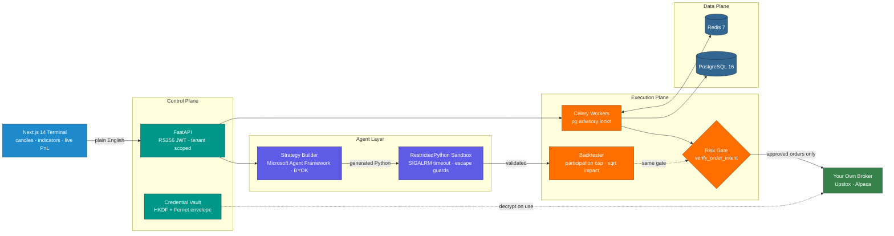
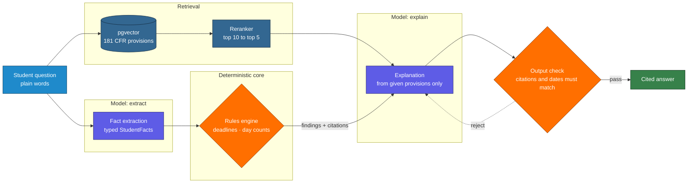
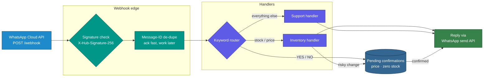
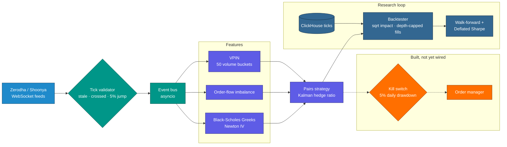
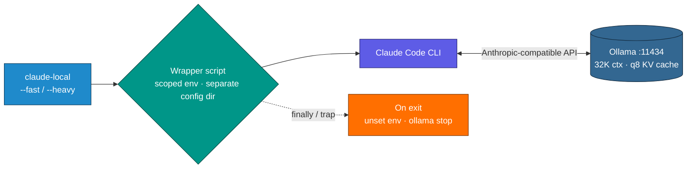

  

  
  

### Hi, I'm Ankit

I'm an AI engineer and data scientist, an NIT Jaipur graduate living in Gurgaon. I build LLM systems for places where a wrong answer costs something real: money in a brokerage account, a student's visa deadline, a shop's stock.

> **The model proposes. Code decides.**
> I let LLMs extract, draft and explain. The parts that have to be right (an order, a date, a stock change) stay in plain, tested code.

The clearest examples are AlphaSwarm, where a risk gate sits in front of every broker call, and Niyam, where deadlines are computed in tested code and citations are checked before an answer ships. agent-towhatsapp applies the same idea at a smaller scale: price and zero-stock changes wait for the owner's "YES".

**Right now** I'm running Niyam's answer-quality evals and building a TypeScript Telegram agent for small shops (private for now).

 

## Selected work

### [AlphaSwarm](https://github.com/Algo-Ankit/AlphaSwarm): an LLM writes the strategy, a risk gate decides whether it trades

A multi-tenant trading platform. You describe a strategy in English. An agent writes it as Python, a hardened sandbox runs it, and a backtester tests it against realistic fills. Only then can it reach your own broker account. AlphaSwarm never holds funds.

- `verify_order_intent()` runs 9 checks before any order, including a 3% gap-safety margin when no live tick exists. The backtester, the live executor and the worker all call the same function, so there is no path that skips it.
- The backtester caps fills at 10% of volume, fills gapped stops at the adverse open, accrues short-borrow cost and uses a true downside-RMS Sortino.
- The sandbox blocks str-subclass and `format` escapes. 28 of the 117 tests target it directly. CI runs lint and pytest on every push.

FastAPI · Celery · PostgreSQL · Redis · Microsoft Agent Framework · Next.js · Prophet · Docker · GitHub Actions

 

### [Niyam](https://github.com/Algo-Ankit/Niyam): OPT work-rules assistant that cites the regulation and never computes a date with a model

F-1 students describe their situation in plain words. Niyam returns the rules that apply from 8 CFR 214.2(f), with the paragraph cited, every deadline as a date, and the unemployment days used against the 90-day limit.

- On a 35-question test split I wrote myself, vector retrieval reaches hit@1 0.857 against 0.086 for keyword search. Hybrid fusion scored below vector alone, and the write-up reports that.
- Reranking lifts hit@1 from 0.900 to 0.983 on a 60-question dev split. The bootstrap interval is published with it, and the lower bound is zero. There's no external benchmark yet.
- 108 tests, `mypy --strict`, and a pre-commit hook that runs lint, types and tests.

Python 3.12 · Gemini · Gemma · pgvector · PostgreSQL · SQLite · pytest · mypy

 

### [agent-towhatsapp](https://github.com/Algo-Ankit/agent-towhatsapp): run a small shop's inventory from WhatsApp

A FastAPI bridge between the WhatsApp Cloud API and two handlers, one for inventory and one for support. A shop owner texts in plain language, and risky changes are held until they reply "YES". It's demo-grade: routing is keyword-based and there are no tests yet.

- The webhook signature is verified on the raw body, so a forged request gets a 401 before anything is parsed. Meta's retries are de-duplicated by message ID.
- The webhook acknowledges at once and the work runs in the background, so a slow handler never triggers redelivery.

Python · FastAPI · WhatsApp Cloud API

 

### More projects

<b><a href="https://github.com/Algo-Ankit/TradeProject">TradeProject</a></b>: research stack for systematic trading on NSE India (paper only). Click for architecture.

 

The feed, features, Deflated Sharpe check and backtester work end to end. The kill switch and pre-trade checks are built and unit-tested but not yet wired into a live order path, so those are shown dashed. It's an early-stage repo: about 7 commits, 45 tests and no CI yet.

<b><a href="https://github.com/Algo-Ankit/claude-code-local-models-runtime">claude-code-local-models-runtime</a></b>: run Claude Code on local Ollama models with an isolated config and VRAM sizing maths. Click for architecture.

 

 

## Toolbox

## Off the clock

I keep my algorithm skills sharp in C++ ([LeetCode](https://github.com/Algo-Ankit/Leetcode_Solutions), [DSA and CSES](https://github.com/Algo-Ankit/DSA)). Away from the keyboard I play tennis and FPS games.

The fastest way to reach me is a LinkedIn DM. I'm happy to talk about AI engineering roles, applied LLM systems and quant tooling.

  

